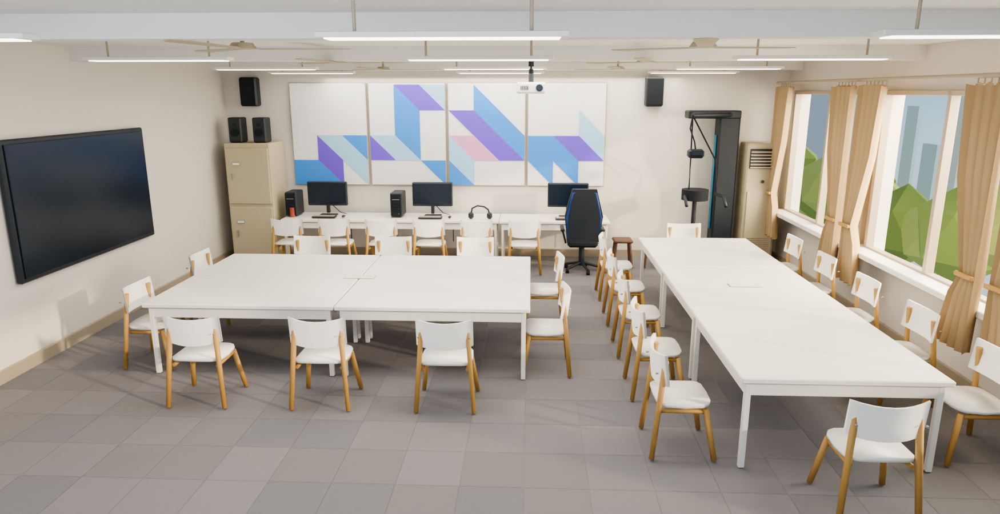

# 3DAlab

3D 打印工具与三维互动实验室。网站由自己的 Windows 电脑提供服务，可通过 Cloudflare Tunnel 对外访问。

这是当前已发布程序的公开源码快照。后续交互改进仍在开发，图片用于展示场景与角色资产。



## 包含内容

- 白模入口、118 三维实验室、yd 工具工作台与角色资源。
- 猫猫牌 3D、干瞪眼、文字与图片聊天、工作区、拼豆及积分相关源码。
- 标识字核算、平面灯罩、深度图模型与针织效果切片模块。
- 本机管理员控制台、模块加载与版本管理。

## 本地运行

需要 Node.js 24 或更高版本。

```powershell
npm install
npm run setup
npm start
```

- 网站：http://127.0.0.1:18765/
- 管理控制台：http://127.0.0.1:18768/console/，首次在本机设置自己的管理员密码。
- 本仓库的本地示例空间代码：118000118、yd000d。它们不对应正式网站的访问凭据。
- setup 只把随仓库提供的模块源码复制到新建的本地运行目录，不覆盖已有数据。
- 启动3DAlab.cmd 和 start.ps1 是原 Windows 部署入口，另需自行准备 runtime/ 中的 Node、cloudflared 及自己的隧道配置。纯源码体验使用上面的 npm start。

## 可选运行资源

- 深度推理：自行准备兼容的 depth-anything-v2-small.onnx，放在 integrations/depth/models/。模型权重不随仓库发布。
- 本机切片：自行安装 Bambu Studio；可通过 KNITFORM_BAMBU_STUDIO 指定程序路径。
- 第三方引擎、库的已有 LICENSE 和说明保留在相应目录。

## 源码结构

```text
admin/             本机管理控制台
community/         共享场景、聊天、作品、资料与积分
public/            网页、Three.js 引擎与三维资产
integrations/      内置工具与游戏实现
bundled-modules/   当前启用模块的源码快照
config/            不含用户数据的模块版本配置
modules/           模块加载和管理
scripts/           本地初始化
```

## 数据与部署

仓库不包含正式站点的访问密钥、隧道凭据、管理员密码、用户资料、聊天记录、图片上传、积分/借还记录、运行日志及数据库。正式环境需要使用自己的配置和新建数据目录。

可参考 [3DAlab 网站](https://yongdian3d.asia)；仓库中的示例代码不能用于登录该站点。
